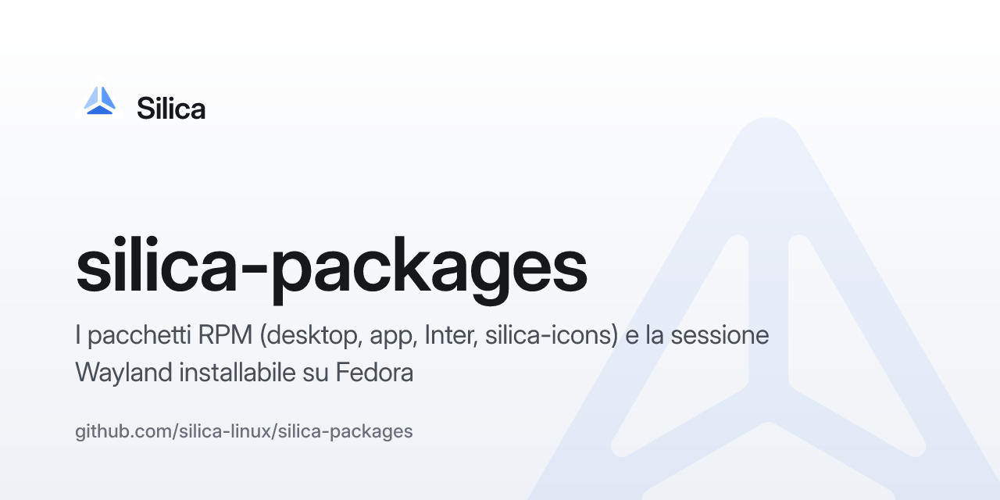

# silica-packages

I pacchetti di [Silica](https://github.com/silica-linux/silica-desktop) per Fedora: il desktop
(Ossido, shell, daemon, portali, embedder), le app (Mustache, Impostazioni, …), Inter e
silica-icons, e la sessione Wayland selezionabile dalla schermata di login.

È il primo passo verso la distro: Silica installabile su una Fedora qualsiasi, senza
reinstallare. Le stesse spec servono all'immagine di `silica-os`.

Da fare:
- spec RPM per ogni componente, costruite in CI e pubblicate (COPR);
- la voce di sessione (`wayland-sessions/silica.desktop`) e l'avvio di Ossido con shell,
  daemon e portali;
- versioni allineate ai tag dei repository sorgente.
